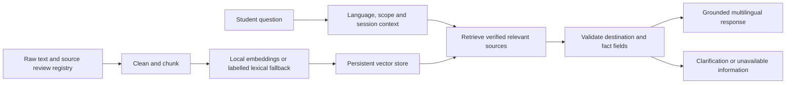

# TPC NavBot

A campus assistance prototype for Talibon Polytechnic College (TPC), with English, Bisaya, and Tagalog responses. The bot handles campus locations and supported campus services, rejects unrelated requests, and withholds unverified facts and routes.

**Data status:** the 30 text files in `data/raw/` are generated sample documents. They demonstrate the capstone pipeline; they are **not official or verified campus records**. The source registry leaves them unverified. A normal question about their locations should return an honest unavailable-information response until an authorized reviewer supplies real evidence.

Read [the requirements audit](docs/00_requirements_audit.md) for what is complete, partial, and still dependent on real-world evidence. The earlier README's claims of full checkpoint scores, verified documents, and completed deployment were unsupported.

The existing `TPC_NavBot_Checkpoint_1_Report.docx` is an obsolete report with unsupported grade/statistics and navigation claims. Use the corrected documentation and actual evaluation artifacts when preparing a submission.

## Run locally

From this directory:

```powershell
python -m venv .venv
.\.venv\Scripts\Activate.ps1
python -m pip install -r requirements.txt
Copy-Item .env.example .env
python run_app.py
```

Open `http://localhost:8501`. The app supports an offline, deterministic mode without a Gemini API key. Keep `.env` private. Check `.env.example` for optional settings; enable a cloud model only when that deployment is authorized to send student questions and candidate campus record fields to the provider.

```powershell
python cli_chat.py
python -m src.ingestion --force
python tests/run_tests.py
python scripts/demo_checkpoint3.py
```

The regression suite uses explicitly fictional test fixtures to exercise verified-answer behavior. Test review records are not evidence about the actual TPC campus.

## Architecture



LangChain orchestration is used when the framework dependency is installed; a lightweight fallback keeps the core available offline. Optional Gemini selection is constrained to source IDs from retrieved evidence. The final response uses reviewed fact fields, so a generated route cannot enter the answer through the model.

`auto` embedding mode uses a locally available Sentence Transformers model when possible. If unavailable, it explicitly reports lexical hashing. The [measured lexical and semantic comparison](docs/04_distance_metric_report.md) identifies both actual backends and gives reproduction commands. Metric JSON outputs and local MiniLM weights are excluded from Git; provision a model explicitly on a fresh machine and set `TPC_EMBEDDING_MODEL` to its absolute local directory for semantic mode. The lexical fallback is not a semantic language model.

## Trust and route policy

Verification lives in `data/source_registry.json`, outside document text. A source is eligible only with a matching SHA-256, approved source type, official reference, reviewer, and review date. Editing reviewed source bytes invalidates that approval. Document headings such as "official" never grant trust.

Reviewed location fields and route fields are separate. A verified office location does not establish directions, walking time, accessibility, or a starting point. Missing route evidence produces a route-unavailable response. See [the verification workflow](docs/09_source_verification.md) before adding real campus information.

## Containers

```powershell
docker compose up --build
```

The Dockerfile uses separate build and runtime stages. The runtime runs as a non-root user. Configuration and credentials belong in deployment environment variables, not in the image or repository. Local container configuration is not proof of a cloud deployment. See [deployment and evidence requirements](docs/07_deployment_and_containerization.md).

## Project files

- `src/`: preprocessing, provenance checks, embeddings, vector retrieval, memory, and response orchestration.
- `data/raw/`: 30 generated sample documents; `data/source_registry.json`: review metadata.
- `app.py`, `cli_chat.py`: web and terminal interfaces.
- `tests/`, `scripts/`: regression tests, demo, and evaluation entry points.
- `docs/`: audit, proposal, data reflection, prompt design, measured metric comparison, framework comparison, customization rationale, deployment guide, final report, and defense plan.

## Evidence and attribution

The [metric comparison](docs/04_distance_metric_report.md) reports an actual offline run, including retrieval failures. It does not claim campus accuracy or a student usability study. No training experiment, live cloud API success, remote deployment, or completed defense is claimed without a retained artifact.

This project includes AI-assisted implementation and generated sample text. Review and explain that assistance in the course submission. The audit records the supplied semester guide and behavioral guidelines as requirements sources; official library documentation and research references appear in the relevant reports.
